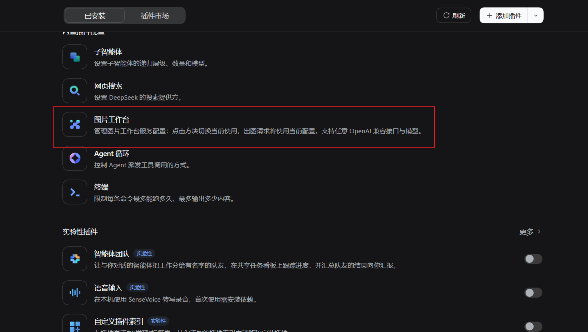
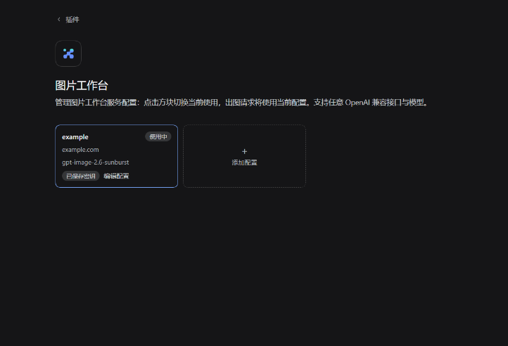
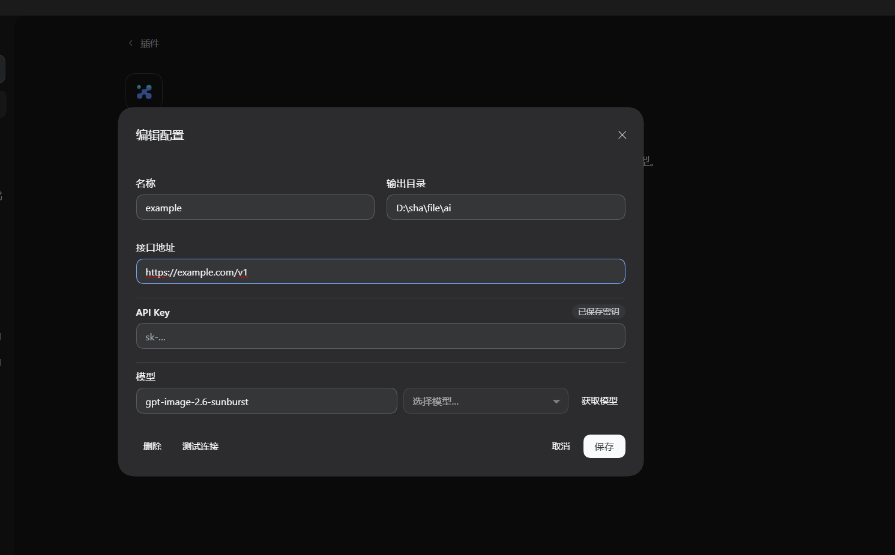

# dsh-image-studio

DSH（DeepSeek Harness）插件：在 DSH 里管理多套图片生成服务，并在对话中直接出图。

界面中显示为**图片工作台**。不绑定厂商——只要接口兼容 OpenAI 的 `/images/generations`，都能接进来。

## 功能

- **多套配置**：地址、API Key、模型、输出目录分别保存，点方块切换当前使用
- **模型列表**：按「地址 + Key」拉取 `/models`，下拉选择或直接输入模型 ID
- **文生图与图生图**：只给描述就出图；给参考图则按图编辑
- **密钥安全**：API Key 存在凭据存储里，配置文件只留引用名

## 界面

插件出现在「插件 → 已安装」列表里：



进入后每套配置是一个方块，点一下就切换为当前使用：



点方块里的「编辑配置」或 `+ 添加配置` 打开配置弹窗：



## 安装

**有 dsh CLI 时**（把 `desktop` 换成你的 profile 名，通常是 `desktop` 或 `web`）：

```bash
# 从 npm 装（推荐，预构建、无需构建授权）
dsh plugin --profile desktop add @shamanjin/dsh-image-studio

# 或直接从 GitHub 仓库装
dsh plugin --profile desktop add github:shamanjin/dsh-image-studio
```

也可以装 Release 里的包：

```bash
dsh plugin --profile desktop add "https://github.com/shamanjin/dsh-image-studio/releases/download/v1.0.0/dsh-image-studio-1.0.0.tgz"
```

**只有桌面版、没有 dsh CLI 时**（桌面应用不带 CLI，`dsh` 会提示命令不存在）：

1. 下载 Release 里的 `dsh-image-studio-1.0.0.zip`，解压到任意目录，例如 `C:\dsh-plugins\dsh-image-studio`

2. 把它链接进 profile 的 `node_modules`（注意包名带作用域，目录嵌在 `@shamanjin` 下）：

   ```powershell
   New-Item -ItemType Directory "$env:USERPROFILE\.dsh\profiles\desktop\node_modules\@shamanjin" -Force
   New-Item -ItemType Junction `
     -Path "$env:USERPROFILE\.dsh\profiles\desktop\node_modules\@shamanjin\dsh-image-studio" `
     -Target "C:\dsh-plugins\dsh-image-studio"
   ```

3. 打开 `%USERPROFILE%\.dsh\profiles\desktop\package.json`，在 `dsh.profile.bundles` 数组里加一项 `"@shamanjin/dsh-image-studio"`

4. 重启 DSH

两种方式装完都重启 DSH，然后侧栏 → 插件 → **图片工作台**。

> 命令里的 `<profile>` 是占位符，要替换成实际 profile 名再执行；PowerShell 里 `<` 是保留字符，原样粘贴会报「`<`运算符是为将来使用而保留的」。

## 使用

**1. 配置一套服务**

侧栏 → 插件 → 图片工作台 → `+ 添加配置`：

- 接口地址：填到 `/v1` 层，例如 `https://api.example.com/v1`
- API Key：填完随「保存」一起写入
- 模型：点「获取模型」拉列表，在下拉里选；也可以直接输入模型 ID
- 输出目录：可留空

**2. 对话里出图**

配好后回到对话，直接说要什么：

- 「画一张雨夜的乡村车站，动画电影风格」
- 「参考 `D:\images\a.png`，把背景换成雪夜」

出图后返回本地图片路径，并以图片形式展示。

## 说明

| 项 | 说明 |
|---|---|
| 输出目录 | 留空时保存到当前工作目录下的 `dsh_outputs/images` |
| 密钥存放 | `~/.dsh/.credentials.yaml`，配置文件里只有引用名 |
| 生效范围 | 只使用当前选中的那套配置，模型侧无法改地址、Key 或模型 |
| 本地接口 | `/dsh-image-studio/*` 只接受本机 Host、同源请求与 `application/json`；网页跨站调用会被拒 |

## License

MIT
